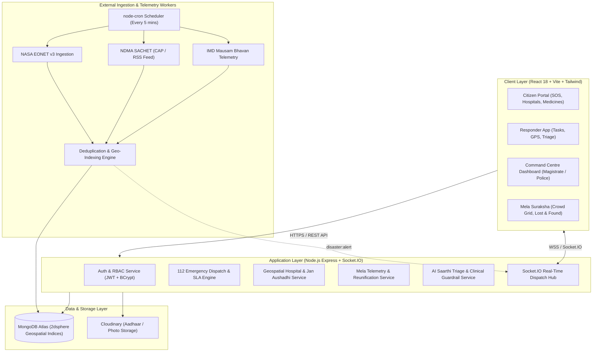

# 🏛️ SevaSaarthi System Architecture & Technical Design

This document provides a direct overview and links to the comprehensive Technical Design Document.

> 📄 **Full Technical Design Document**: Please refer to [docs/TECHNICAL_DESIGN_DOCUMENT.md](docs/TECHNICAL_DESIGN_DOCUMENT.md) for the complete design specification including data ingestion pipelines, ER models, and SLA escalation state machines.

---

## High-Level Architecture Overview

---

## Key Modules
1. **Disaster Saarthi & GIS Radar**: Multi-source telemetry ingestion from NASA EONET v3, NDMA SACHET, and IMD Mausam Bhavan with 5-minute cron sync and duplicate filtering.
2. **112 Emergency Dispatch & Triage**: Sub-3 minute SLA timer with magistrate escalation on breach.
3. **Healthcare & Jan Aushadhi**: 2dsphere proximity search for 24x7 hospitals, blood banks, and generic medicines up to 75% cheaper.
4. **Mela Suraksha**: Crowd density grid monitoring, CCTV integration, and missing-person reunification.
5. **Security & Compliance**: JWT authentication, Aadhaar verification for first responders, and clinical red-flag triage guardrails.
