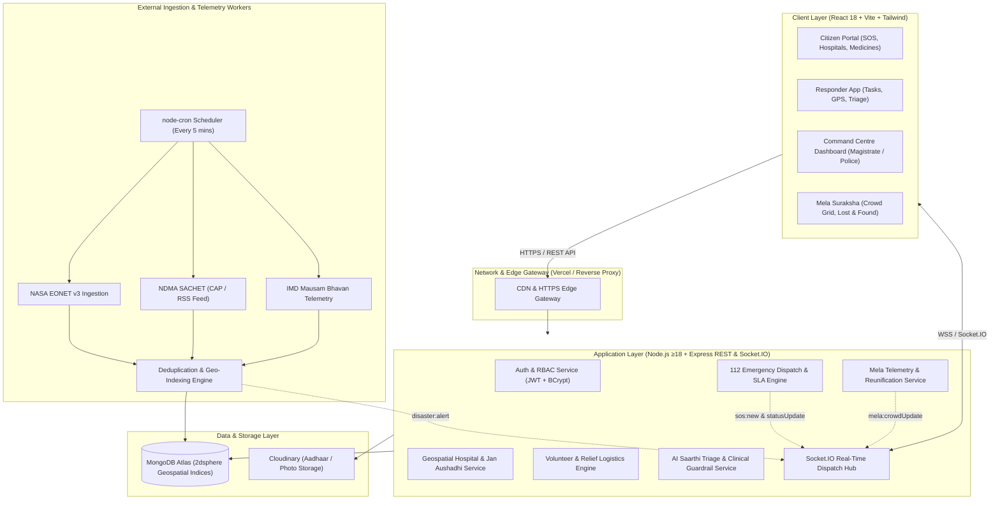
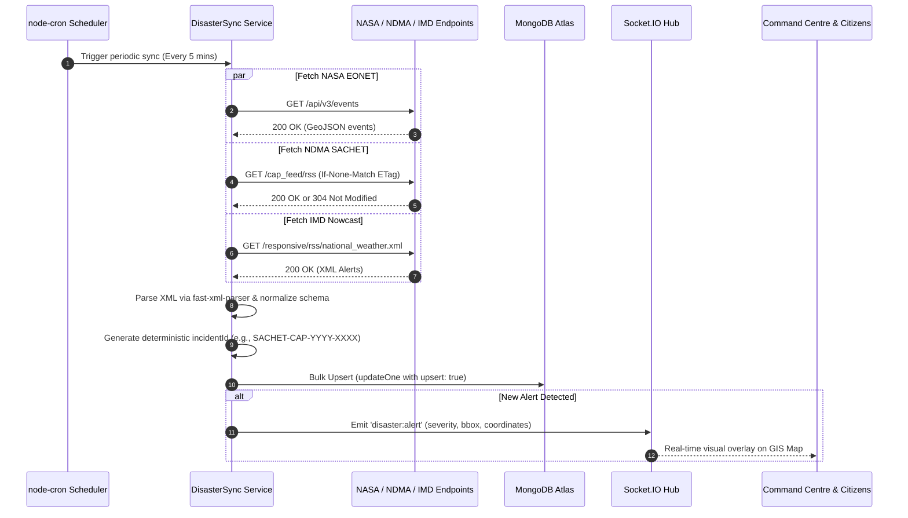
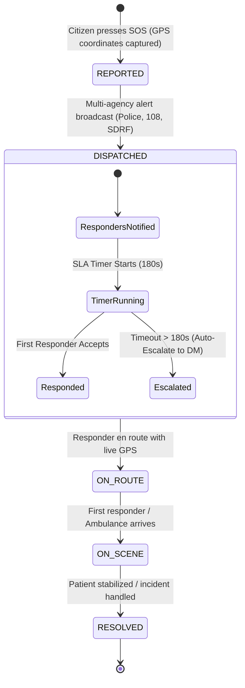
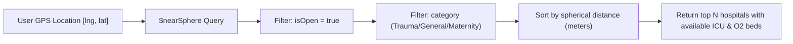
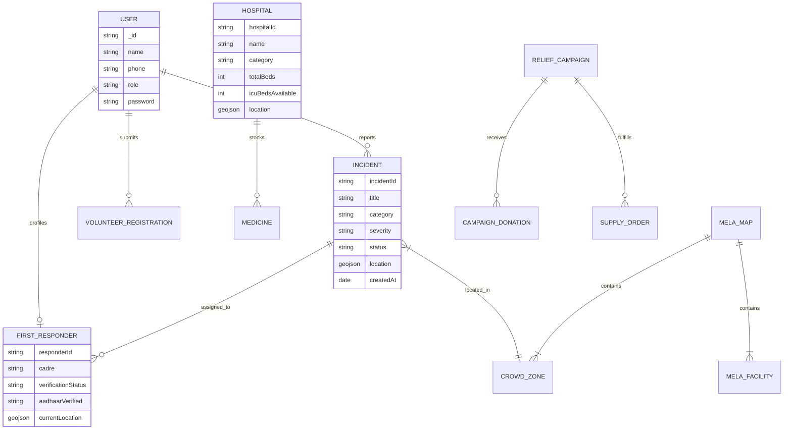

# 🏛️ SevaSaarthi — Technical Design Document (TDD)
### *Technology for Safer Communities — Integrated Civic Emergency, Healthcare & Disaster Mitigation Platform*

---

## 1. Executive Summary & System Objectives

**SevaSaarthi** (*सेवा सारथी*) is a mission-critical civic platform designed to tackle fragmentation across emergency healthcare, natural disaster management, mass gathering crowd safety, and relief logistics in India. 

### Core System Objectives
1. **Sub-3 Minute Emergency Dispatch**: Connect citizens to the nearest verified first responder and multi-agency 112 dispatch (Police, 108 ALS Ambulance, SDRF, Fire).
2. **Unified Early Warning Telemetry**: Ingest and deduplicate real-time disaster alerts from NASA EONET v3, NDMA SACHET (CAP/RSS), and IMD Mausam Bhavan.
3. **Affordable Healthcare Accessibility**: Geospatial 2dsphere indexing for nearest hospitals and Pradhan Mantri Jan Aushadhi generic medicine discovery offering up to 75% cost savings.
4. **Mass-Gathering Safety (Mela Suraksha)**: Real-time sector-wise crowd density telemetry, AI-assisted lost & found registry, and missing-person reunification.
5. **High Availability & Low-Bandwidth Resilience**: Offline-tolerant caching, ETag conditional queries, and WebSocket real-time broadcast.

---

## 2. High-Level System Architecture



---

## 3. Data Ingestion & Deduplication Pipeline

Disaster feeds are ingested on an automated cron schedule (`*/5 * * * *`). The engine handles XML and JSON responses with ETag caching to prevent redundant bandwidth consumption.



---

## 4. 112 SOS Incident Lifecycle & SLA Escalation State Machine

Every emergency incident is governed by an automated SLA clock. If first responders or official agencies fail to acknowledge within 3 minutes, the incident escalates to the District Magistrate Command Officer.



---

## 5. Geospatial 2dsphere Query Architecture

To ensure millisecond response times when querying nearest hospitals and first responders, MongoDB's `2dsphere` geospatial indexing is utilized:



### Geospatial Index Definition
```javascript
// Hospital Schema Geospatial Index
HospitalSchema.index({ location: "2dsphere" });

// First Responder Live GPS Index
FirstResponderSchema.index({ currentLocation: "2dsphere" });
```

---

## 6. Real-Time WebSocket Protocol Matrix

All real-time communications are coordinated via Socket.IO across specialized channels:

| Event Name | Direction | Payload Structure | Purpose |
| :--- | :--- | :--- | :--- |
| `sos:new` | Server → Client | `{ incidentId, title, category, severity, coordinates, timestamp }` | Broadcast new emergency to Command Centre & nearby responders |
| `sos:statusUpdate` | Server → Client | `{ incidentId, status, responderId, responderName, eta }` | Real-time status update to citizen tracking screen |
| `mela:crowdUpdate` | Server → Client | `{ zoneId, zoneName, densityLevel, currentOccupancy, riskScore }` | Live updates to Kumbh Mela crowd density heatmap |
| `disaster:alert` | Server → Client | `{ incidentId, source, title, severity, coordinates, radius }` | Immediate GIS banner and map marker update |
| `responder:location` | Client → Server | `{ responderId, coordinates: [lng, lat] }` | Continuous telemetry during active dispatch missions |

---

## 7. Database Entity Relationship (ER) Model



---

## 8. Security, Verification & Clinical Safety Architecture

1. **Authentication & Authorization**:
   - Industry-standard JSON Web Tokens (JWT) using `ACCESS_TOKEN_SECRET` with configurable expiry.
   - BCrypt salted password hashing (work factor 10).
   - Strict Role-Based Access Control (`citizen`, `responder`, `admin`, `magistrate`).
2. **First Responder Credentialing**:
   - Verification workflow ensuring all voluntary responders undergo Aadhaar OTP validation.
   - Mandatory official government photo ID upload stored on Cloudinary with encrypted signed URLs.
   - Mandatory admin approval gate before a responder can be dispatched to live incidents.
3. **AI Saarthi Clinical Safety Guardrails**:
   - Rule-based regex filter identifying life-threatening emergency symptoms (`chest pain`, `profuse bleeding`, `unconscious`, `snake bite`, `stroke`).
   - Emergency red flags trigger an immediate 112 SOS bypass modal rather than plain-text medical advice.
   - Non-prescriptive clinical disclaimers enforced across all AI responses.

---

## 9. Technology Stack & Deployment Architecture

| Layer | Component | Hosting / Service |
| :--- | :--- | :--- |
| **Frontend** | React 18, Vite 5, Tailwind CSS, Leaflet.js, Recharts | Vercel (Edge CDN) |
| **Backend API** | Node.js ≥ 18, Express 4.x | Render (Container Web Service) |
| **Realtime Engine** | Socket.IO 4.x WebSocket Server | Render Web Service |
| **Database** | MongoDB Atlas with 2dsphere indexes | MongoDB Atlas Cloud (M0 / Dedicated) |
| **Media Storage** | Cloudinary CDN | Cloudinary Secure Assets API |
| **Scheduled Tasks** | node-cron (5-minute intervals) | Node.js Background Worker |
